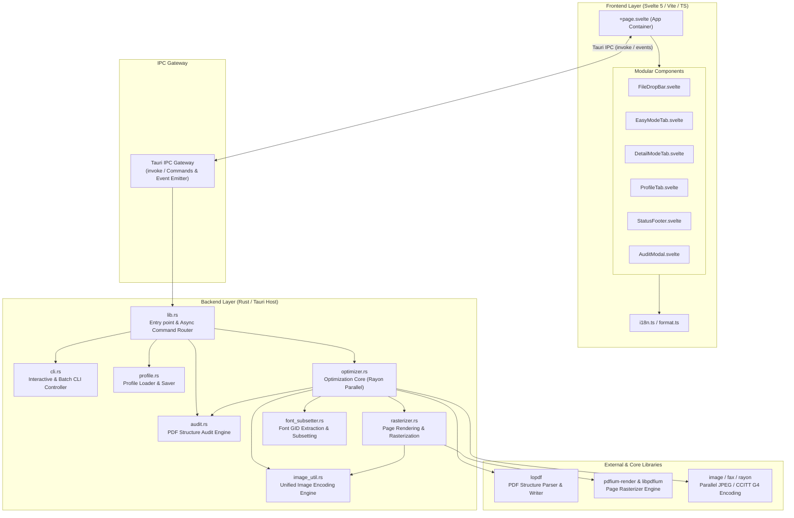

# システムアーキテクチャ設計書 (`MinuoPDF`)

本ドキュメントは、**MinuoPDF** アプリケーションのシステム構成、コンポーネント責務、データフロー、および境界設計を定義します。主要な設計トレードオフの根拠は [adr/README.md](adr/README.md)、モジュールごとの詳細仕様は [design/README.md](design/README.md) を参照してください。

## 1. システム構成概要

MinuoPDF は、フロントエンド層（Svelte 5）、IPC ゲートウェイ（Tauri v2）、およびバックエンド層（Rust）の 3 層アーキテクチャで構成されます。

---

## 2. アーキテクチャコンポーネント一覧

| コンポーネント ID | モジュール / 領域 | 責務概要 | 対応要件 | 詳細設計 |
| :--- | :--- | :--- | :--- | :--- |
| `ARCH_FE_001` | `src/` (Svelte 5) | モジュラー UI・状態管理・日英動的 i18n | `REQ_GUI_001`, `REQ_GUI_002`, `REQ_GUI_003`, `REQ_FILE_001` | [gui.md](design/gui.md) |
| `ARCH_IPC_001` | `src-tauri/src/lib.rs` | Tauri `invoke` ハンドラと非同期進捗イベント配信 | `REQ_GUI_004`, `REQ_GUI_005` | [gui.md](design/gui.md) |
| `ARCH_BE_CLI` | `src-tauri/src/cli.rs`, `main.rs` | CLI/GUI 分岐、対話/非対話バッチ実行、Win32 コンソール制御 | `REQ_CLI_001`, `REQ_CLI_002`, `REQ_NFR_003` | [backend.md](design/backend.md) |
| `ARCH_BE_PROF` | `src-tauri/src/profile.rs` | `profiles/` からの JSON プロファイル読み書き・v2 検証 | `REQ_PROF_002`, `REQ_NFR_002` | [backend.md](design/backend.md) |
| `ARCH_BE_OPT` | `src-tauri/src/optimizer.rs`, `image_util.rs` | `lopdf` 走査、Rayon 並列処理、CTM DPI、Form/SMask、Smart Fallback | `REQ_OPT_001`..`005`, `REQ_OPT_007`, `REQ_OPT_008`, `REQ_PERF_001` | [backend.md](design/backend.md) |
| `ARCH_BE_RAST` | `src-tauri/src/rasterizer.rs`, `pdfium_util.rs` | `pdfium-render` 動的ロードとページ全体ラスタライズ | `REQ_OPT_004`, `REQ_NFR_002` | [backend.md](design/backend.md) |
| `ARCH_BE_FONT` | `src-tauri/src/font_subsetter.rs` | CID マッピング解析、GID サブセット化、埋め込み解除 | `REQ_OPT_006` | [backend.md](design/backend.md) |
| `ARCH_BE_AUDIT` | `src-tauri/src/audit.rs` | 6 カテゴリ容量解析（ディスク & インメモリ前後比較） | `REQ_AUDIT_001`, `REQ_PERF_001` | [backend.md](design/backend.md) |

### コンポーネント詳細

- **`ARCH_FE_001` (フロントエンド UI & ステート管理)**: Svelte 5 を採用したモジュラー SPA。Catppuccin Mocha ダークテーマに基づき、幅 740px・高さ 560px を初期値としつつ最小 680×520px 制約付きで柔軟にリサイズ可能なレイアウトを提供する。責務ごとに分割されたコンポーネント群（`FileDropBar`, `EasyModeTab`, `DetailModeTab`, `ProfileTab`, `StatusFooter`, `AuditModal`）と型定義・辞書モジュール（`types/index.ts`, `i18n.ts`）で構成される。
- **`ARCH_IPC_001` (Tauri IPC ゲートウェイ)**: Tauri v2 `invoke` 非同期メッセージハンドラ（`spawn_blocking` による UI ブロッキング防止）およびイベントエミッター。進捗状況（0-100%）、非同期ログ出力、およびインメモリ計算された容量監査比較（`PdfAuditComparison`）をフロントエンドにリアルタイム配信する。
- **`ARCH_BE_CLI` (CUI コマンドラインコントローラ)**: 起動引数の有無およびオプションフラグを判定し、単体 PDF 指定時は対話型コンソールメニュー、オプション指定時（`-o`, `-p`, `--profile`, `-s`, `-b`）は非対話ヘッドレスバッチ実行を行う。
- **`ARCH_BE_PROF` (プロファイルマネージャ)**: 実行ファイルと同一階層の `profiles/` サブディレクトリから JSON プロファイルを動的に検出・ロードし、バージョン検証（v2 以上）を行う。
- **`ARCH_BE_OPT` (最適化コアエンジン)**: `lopdf` クレートを用いて PDF オブジェクトツリーを走査・書き換えする。Rayon による画像タスク並列処理、CTM 実効 DPI 算出、Form XObject 再帰走査、透過 SMask 連動リサイズ、逆圧縮防止（Smart Fallback）、不要辞書キー削除、および Deflate 再圧縮を行う。
- **`ARCH_BE_RAST` (ページラスタライザ)**: `pdfium-render` を介して PDFium を動的ロードし、ページ全域を高精細レンダリングして画像化（ラスタライズ）する。
- **`ARCH_BE_FONT` (フォント処理エンジン)**: PDF 内の TrueType/OpenType フォントの CID マッピング解析、サブセット化、および埋め込みストリーム（`FontFile` / `FontFile2` / `FontFile3`）の安全な削除処理を行う。
- **`ARCH_BE_AUDIT` (PDF 容量内訳解析エンジン)**: PDF 内の全オブジェクトおよびストリームを走査し、Images, Fonts, Content Streams, Metadata/Catalog, Struct/Forms, Other のカテゴリ別に容量内訳（バイト数・パーセンテージ）をインメモリで解析・集計する。最適化パイプラインと密結合し、重複ディスク I/O を発生させずに前後比較を生成する。

---

## 3. 信頼境界・ライセンス境界

1. **Tauri Capabilities / IPC 境界**: `src-tauri/capabilities/default.json` で許可した最小限のプラグイン権限（ダイアログ・オープナー・IPC）のみをフロントエンドへ公開し、PDF バイナリ I/O や外部ライブラリ実行は Rust バックエンド側に限定する。
2. **外部動的ライブラリ境界 (`pdfium`)**: 実行ファイルと同階層の `pdfium.dll` / `libpdfium.so` を優先探索して動的ロードする設計とし、システムパス混在による予期せぬバージョン不整合を抑止する。
3. **非 GPL ライセンス境界**: 依存クレートおよびネイティブライブラリを `MIT` / `BSD-3-Clause` / `Apache-2.0` のみに限定し、コピーレフト伝播を構造的に排除する。

---

## 4. 関連 ADR 索引

アーキテクチャ選定の背景と採択根拠は [adr/README.md](adr/README.md) に記録しています。
