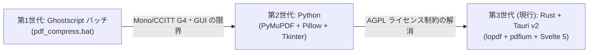

# 概要・開発背景・技術的変遷 (`MinuoPDF`)

本ドキュメントでは、**MinuoPDF** を開発した背景、3つの世代にわたる技術スタックの変遷、既存手法との違い、および主要な技術的柱を整理します。

## 1. 背景と技術スタックの変遷

本プロジェクトは、PDF の閲覧品質やレイアウトを維持しながらファイルサイズを極限まで削減することを目的として開発されてきました。機能要件の高度化とライセンス制約の解消に伴い、以下の 3 つの世代を経て進化しています。

### 第 1 世代: Ghostscript バッチ時代 (`pdf_compress.bat`)

- **構成**: Ghostscript CLI を呼び出す Windows バッチスクリプト。
- **課題**:
  1. **モノクロ (Mono) 化への未対応**: Ghostscript の制約上、白黒二値（1-bit）への高品質な変換と CCITT Group 4 圧縮の適用が困難であった。
  2. **圧縮率の限界**: DPI や画質の調整だけでは、スキャン文書等のサイズ削減に限界があった。
  3. **使い勝手**: ドラッグ＆ドロップ中心の CUI ベースであり、詳細な設定を画面上で確認・調整できる GUI が存在しなかった。

### 第 2 世代: Python 時代 (`PyMuPDF` + `Pillow` + `Tkinter`)

- **構成**: PyMuPDF (`fitz`) と Pillow による画像処理・PDF 再構成エンジン + Tkinter GUI。
- **成果**: Color / Gray / Mono（大津の二値化 / Floyd-Steinberg ディザリング）変換、テキスト保持（Keep Text）/ 完全ラスタライズ（Rasterize）戦略を確立。
- **課題（ライセンス問題）**:
  - PyMuPDF は **AGPL (GNU Affero General Public License)** であり、クローズド環境や商用利用・再配布において厳しいソースコード開示義務等が存在した。

### 第 3 世代（現行）: Rust + Tauri v2 時代 (`MinuoPDF`)

- **構成**: Svelte 5 + Vite フロントエンド + Tauri v2 IPC + Rust（`lopdf` / `pdfium-render` / `image` / `rayon` / `fax` / `allsorts`）バックエンド。
- **達成事項**:
  1. **厳格な非 GPL ライセンス構成**: AGPL/GPL 依存を完全に排除し、`MIT` / `BSD-3-Clause` / `Apache-2.0` のみで全機能を実装（詳細は [THIRD_PARTY_NOTICES.md](../THIRD_PARTY_NOTICES.md)）。
  2. **超軽量・ポータブル性**: UPX 等に頼らず実行ファイル単体で約 **4.3 MB** のバイナリを実現。同階層の `pdfium.dll` / `libpdfium.so` と `profiles/` のみで完結するスタンドアロン動作。
  3. **高精度な最適化と監査機能**: CTM 実効 DPI 算出、Form XObject 再帰走査、SMask 連動リサイズ、Smart Fallback（逆圧縮防止）、フォントサブセット化・埋め込み解除、6 カテゴリ PDF Audit を搭載。
  4. **モダン UX & 自動化両立**: Catppuccin Mocha テーマ・日英動的 i18n 対応 GUI と、ヘッドレスバッチ / 対話式コンソール CLI を単一バイナリで提供。

---

## 2. 世代・既存アプローチとの比較

| 比較軸 | 第 1 世代 (Ghostscript) | 第 2 世代 (Python / PyMuPDF) | 現行 MinuoPDF (Rust + Tauri v2) |
| :--- | :--- | :--- | :--- |
| コアライセンス | AGPL / GPL | AGPL (PyMuPDF) | **MIT / BSD-3-Clause / Apache-2.0（非 GPL）** |
| 配布形態 | Ghostscript 導入が必要 | Python 環境 / 大容量バンドル | **単体バイナリ + PDFium ライブラリのみ（ポータブル）** |
| モノクロ 1-bit + CCITT G4 | 制約あり | 対応 | **Otsu 二値化 / Floyd-Steinberg + `fax` G4** |
| 圧縮戦略 | 全体再出力中心 | Keep Text / Rasterize | **Keep Text (CTM/Form/SMask対応) / Rasterize** |
| フォント軽量化 | 限定的 | 限定的 | **GID サブセット化 + 安全な埋め込み解除** |
| 容量内訳可視化 | なし | なし | **インメモリ 6 カテゴリ PDF Audit 比較** |

---

## 3. 実践ユースケース

1. **スキャン PDF・FAX 文書の極限軽量化**: `mono`（Otsu 二値化）+ `CCITT Group 4` により、テキストの輪郭を保ったまま大幅な容量削減を実現。
2. **社内・閉域環境でのポータブル配布**: インストーラ・管理者権限不要で、フォルダ展開のみで業務端末から利用可能。
3. **CI / サーバー環境での自動一括圧縮**: `-b <DIR> -p standard` や `--profile` を指定した非対話バッチ CLI で大量 PDF を高速（Rayon 並列）処理。
4. **容量肥大化の原因診断**: PDF Audit 機能により、画像・フォント・メタデータ等のうち何が容量を占めているかを事前確認した上で最適な戦略を選択。
